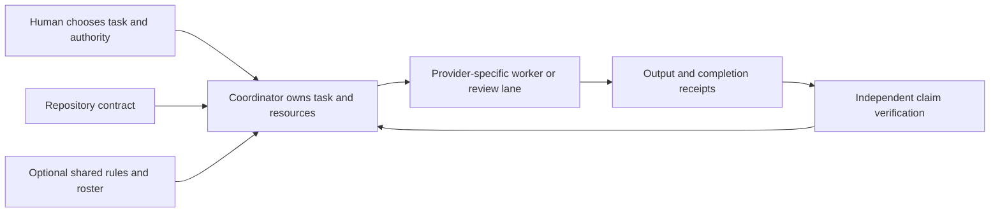

# Agent Operations Kit

A starting set of practices and tools for coordinating coding agents across repositories on macOS.

For individual engineers and small teams using Claude Code and Codex across repositories. The kit helps you decide who owns a task, how much review it needs and how to check the result. It also helps you keep working rules consistent across tools and manage private Claude project memory.

Using different model families for implementation and review can help challenge shared assumptions and expose blind spots. Findings still need independent verification and tests.

## What's inside

- **Rules and templates** for task sizing, agent roles, ownership, independent review and escalation.
- **Small command-line tools** for starting worker and reviewer sessions in supported tools and inspecting whether they actually completed their work.
- **Optional hooks, permission profiles and installers** for selected checks and configuration changes, with documented effects and recovery.
- **Private Claude-memory workflows and runnable examples** for relocation, conflict handling and manual migration between Macs.

Each piece is deliberately small. Extend the roster, rules and hooks to fit your workflow, and keep each repository's own rules authoritative. Start with the documents or the synthetic example below; you do not need to install the whole kit.

**Words used here.** The *coordinator* is the session that owns a task and its Git. A *lane* is one provider process that a launcher starts for a worker or a reviewer. *Receipts* are the files a lane leaves behind, such as `.exit`, `.end` and `.result.json`, so anyone can check what happened. The *standing orders* are shared working rules, and the *roster* says which model each role uses.

> **Experimental and macOS-focused.** Read the [limitations](docs/potential-issues.md) before applying configuration or running agents. The launchers do not run an unseen repository's own settings, hooks or MCP servers; a repository you have already trusted loads as usual. `--project-config` forces that loading, which runs the repository's configuration with your rights, and `--no-project-config` excludes it everywhere. Sessions you start yourself are outside the launchers. Neither choice makes a lane safe for code you do not trust. Shared instructions guide behavior; actual enforcement depends on the platform and its permissions.

Designed and directed by Tiago Fonseca, with implementation and review assisted by coding agents.

New here? The [three engineering lessons](docs/case-studies.md) show the problems this kit grew from, with checks you can run. The [changelog](CHANGELOG.md) lists what changed in each version.

## Try it

Use documents alone: read [the short operating sequence](docs/design.md), adapt the [sample standing orders](agent-orchestration/standing-orders.md), and keep your repository's own contract authoritative. No installation or model call is needed.

Or try the **synthetic two-repository example**. From this checkout's root, using the stock macOS Python 3.9 or anything newer:

```sh
sandbox="$(mktemp -d "${TMPDIR:-/tmp}/agent-ops-demo.XXXXXX")"
python3 examples/check.py --output "$sandbox/demo"
```

Expected: `Synthetic example: PASS (2 repositories; 1 incomplete lane; 1 confirmed claim)` and the path of the created example. The command reads only shipped fixtures and writes only beneath the new `demo` directory. It does not call an agent, install anything or mutate Git. Read [the walkthrough](examples/README.md), inspect the two local contracts, then remove the exact scratch directory when finished. Omit `--output` for a read-only fixture check. See [adoption](docs/adoption.md) for optional installer previews and effects.

`verify.sh`, the Codex launchers and native Codex targets need Python 3.11+. On a stock Mac, run `brew install python` or use a python.org installer, then check `python3 --version`.

## Choose what earns its place

| Component | Useful when | Omit or adapt when | Entry point |
|---|---|---|---|
| Shared rules | Sessions need consistent ownership and evidence language | A repository already says everything needed | [Standing orders](agent-orchestration/standing-orders.md) |
| Role roster and native copies | Several roles need explicit replaceable selections | A single session is enough | [Roster](agent-orchestration/roster.md) |
| Provider adapters | Another platform needs an observable review/write lane | Native tools already supply the needed receipts | [Adapter guide](agent-orchestration/README.md) |
| Native hooks and profiles | You want selected checks and host-level access limits | Your platform/version cannot enforce the intended limit, or you need a boundary against repository content, which [these guards are not](docs/potential-issues.md#guards-catch-mistakes-not-repository-content) | [Permission layers](docs/design.md#four-different-layers) |
| Optional installer | You have inspected a specific configuration effect | Documents alone meet the need | [Adoption](docs/adoption.md) |
| External memory placement | A chosen Claude project needs a private stable store | Local memory is enough or paths/writers cannot be coordinated | [Memory](docs/memory.md) |
| Optional session ledger | You need a local usage/cost estimate | Private transcript access or dated pricing is unsuitable | [Ledger privacy](docs/maintenance.md#optional-local-ledger) |

## How the pieces fit



The coordinator names the owner and checks the result. A launcher supplies observable receipts; it does not decide whether a review is complete or a change should land. Per-provider launchers start provider processes; the kit has no central orchestrator or task graph, background sync, or marketplace installer.

## Independent adoption alongside Warmboot

| Project | Responsibility | Requires the others? |
|---|---|---|
| [Warmboot Light](https://github.com/korreio/warmboot) | Compact repository/session contract and task state | No |
| [Warmboot Full](https://github.com/korreio/warmboot-full) | Deeper repository kickoff, maintenance and release lifecycle | No |
| Agent Operations Kit | Optional operating rules and machine/adapter tools across repositories | No |

A repository retains its own authority, test requirements and state. In the example, one repository can use a Warmboot-style task record while the other uses a short local checklist; both can use the same optional launcher.

## Evidence and next reads

The seven hermetic suites use fake providers and scratch homes. [Verification](docs/verification.md) records the environment, results and CI evidence. [Compatibility](docs/compatibility.md) describes supported environments and dated observations.

- [Design and ownership](docs/design.md): a review sequence and the difference between policy, permissions, guards and verification.
- [Adoption and recovery](docs/adoption.md): documents first, explicit installer targets, linked versus copied files.
- [Memory and multiple Macs](docs/memory.md): external stores, conflict refusal and manual migration.
- [Three engineering lessons](docs/case-studies.md): review completion, permission scope and process identity, with checks you can run.
- [Changelog](CHANGELOG.md): what changed in each version, including the safety hardening before the first release.
- [Maintenance](docs/maintenance.md), [contribution guidance](.github/CONTRIBUTING.md) and [security policy](.github/SECURITY.md).

Read [contribution guidance](.github/CONTRIBUTING.md) when changing the kit.

Ideas, issues and better approaches are welcome.
