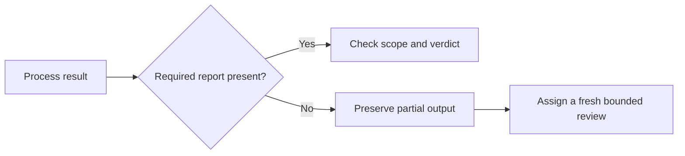
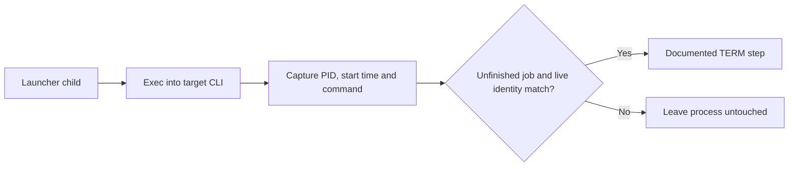

# Three engineering lessons

These examples explain concrete choices in the kit and show what you can inspect or run yourself. Historical observations supply context; [verification](verification.md) separates current fixture results from live platform behavior.

| Situation | Design choice | Reader check |
|---|---|---|
| A process finishes without the required review | Check the report and its scope before accepting completion | Run the synthetic walkthrough |
| A permission rule also blocks a legitimate dependency | Keep the restriction at the specific resource that needs protection | Inspect the generated lane configuration |
| A launcher records a child before it becomes the target CLI | Capture and recheck process identity before cancellation | Run the launcher lifecycle fixtures |

## 1. Check review completion explicitly

A CLI can exit normally without producing the requested review report. Process status describes how execution ended; accepting a review also requires its expected output, checked scope and explicit verdict.



**Try it.** From the kit root:

```sh
python3 examples/check.py
```

The [synthetic walkthrough](../examples/README.md) includes an exit-zero receipt with no verdict, a replacement review and independent claim verification. Expected output: `Synthetic example: PASS (2 repositories; 1 incomplete lane; 1 confirmed claim)`.

**Limit.** This checks the consistency of authored teaching records. Live acceptance remains the coordinator's responsibility; provider-specific receipts need their own interpretation.

## 2. Protect secrets while preserving legitimate dependencies

A public CA certificate bundle and a private key can share the `.pem` extension. An extension-wide denial can therefore prevent the TLS client from reading the trust material it needs for HTTPS.

| Rule choice | Consequence to examine |
|---|---|
| Deny every `.pem` file | Public certificate bundles can become unreadable |
| Deny identified secret locations | Public dependencies can remain accessible; the secret inventory needs maintenance |

In a historical macOS profile probe, narrowing that denial restored HTTPS in the tested environment. The reusable lesson is to trace the denied resource, correct the owning rule and inspect the effective installed configuration, including inherited settings. This concerns the native Codex profile; the Claude fragment's extension-wide rules are a [different layer](adoption.md#sample-policy-effects).

**Inspect it.** From the kit root, print the candidate lane settings without installing them or calling a provider:

```sh
python3 agent-orchestration/codex/lane_config.py reviewer review
```

Compare the output with the [permission fragment](../agent-orchestration/codex/config-fragment.toml) and the paths you intend to deny. Its list of literal denials is minimal and is not a boundary. The helper reads the shipped configuration and role files; it does not inspect your effective installed permissions.

**Limit.** Configuration inspection is not an HTTPS access test or a complete secret inventory. Native access behavior needs a separately authorized probe on the actual platform and version. See [potential issues](potential-issues.md) before live use.

## 3. Capture process identity across the exec transition

A child can retain its PID while changing from a launcher command into the target CLI through `exec`. Recording the intermediate command makes a later identity check reject a legitimate cancellation.



The launcher waits for the expected command within a bounded interval. If identity cannot be recorded, the receipt says so explicitly. Sending TERM to the monitor in `<job>.pid` is the ordinary route; the [direct route](../agent-orchestration/bin/codex_job.sh) to the recorded child requires a fresh identity comparison before signalling.

**Run the checks.** From the kit root, with the prerequisites in [verification](verification.md):

```sh
bash agent-orchestration/tests/test_launchers.sh
```

The suite covers delayed exec, refused process inspection, a child that never becomes the target CLI, and the documented cancellation rule. It uses fake providers; its host-kernel exec case uses a harmless stand-in process and skips explicitly where process inspection is unavailable.

**Limit.** These checks cover the named lifecycle cases. They do not establish safety for arbitrary descendant processes or every operating system.
