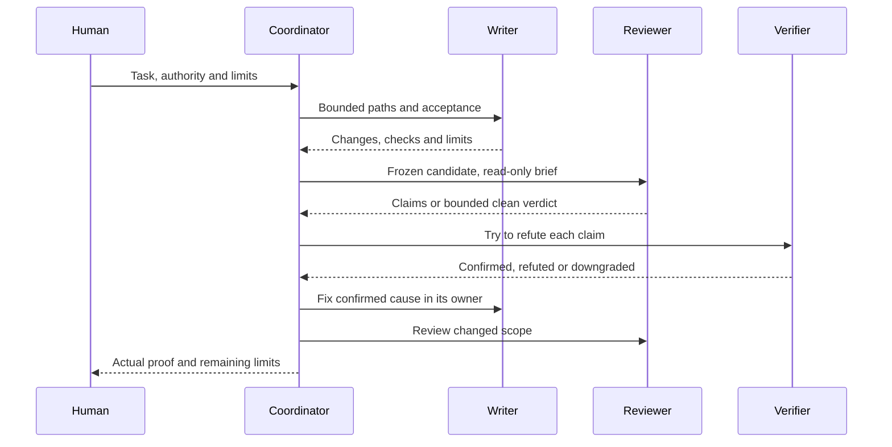

# Design: small mechanisms, explicit ownership

The recurring problem is a coordinator confusing activity with completion: a worker exits, a reviewer says “clean”, or a settings file exists, but nobody checks the outcome that matters. The kit keeps the pieces inspectable and gives each decision a named owner.

## Five terms

- **Lane:** one bounded worker or review assignment, with named files, authority and completion conditions.
- **Receipt:** an observable record of what a process returned or did. A receipt is evidence to inspect, not proof that the assignment is complete.
- **Coordinator:** the session responsible for assigning work, holding shared resources and checking the final result under the repository contract.
- **Roster:** the replaceable mapping from work roles to provider and model selections.
- **Verifier:** someone who checks a review claim against the actual candidate and tries to refute it, independently of the reviewers. A verifier is not one of those reviewers.

Text equivalent: authorize, assign, implement, review, independently verify, fix, check the change, report. A failed lane stays failed until a fresh lane supplies the missing work. A successful process is only one receipt.

## What owns what

| Owner | Holds | Does not inherit |
|---|---|---|
| Human | Task intent, irreversible choices, account and publication authority | A tool's promise of safety |
| Coordinator | Candidate Git, assigned test runner, resource leases, final verification | Permission to edit unrelated work |
| Worker | Named files and bounded tests | Git mutation or another worker's singleton |
| Reviewer | Read-only candidate inspection | Permission to implement its own claim |
| Verifier | Independent attempt to refute each claim | A presumption that severity or proposed fixes are correct |

For small work, one writer and one fresh reviewer can be enough. Larger or riskier packages need deeper and broader review. Read the repository's contract before choosing the lanes; the kit's sample rules are adaptable, not a second authority.

## Four different layers

| Layer | Example | What it establishes | Limit |
|---|---|---|---|
| Policy | “Workers do not mutate Git” in the brief | A clear role and expected behavior | Text is not an access boundary |
| Native permissions | A read-only profile or workspace-scoped writer | The installed harness denies specified operations | Version-sensitive; inherited settings and runtime matter |
| Pattern/parser guard | Hook detects a staging command or secret display | Selected observable command patterns can be refused | Catches mistakes; not a sandbox or a [boundary against repository content](potential-issues.md#guards-catch-mistakes-not-repository-content). Parser absence, hook failure and indirect commands matter |
| Post-run verification | Coordinator checks files, Git state, process liveness and receipts | What the observed run actually changed and completed | Bounded to the checks and evidence retained |

Use the layers together when their costs earn their place. Adding a guard does not repair a wrong state owner.

## How the components fit

Rules describe the collaboration. The [dated roster](../agent-orchestration/roster.md) supplies replaceable role selections and native copies. Provider adapters translate the same collaboration into different CLI behaviors, retaining each provider's completion, denial and partial-result semantics. Hooks and profiles provide selected checks and access controls. The optional installer makes reviewed local configuration changes with backups. External memory is separate private state, placed and migrated manually. Per-provider launchers start provider processes; the kit supplies no central orchestrator or task graph, background sync, or marketplace installer.

Provider permissions need separate inspection: Claude reviewers use a file-reading built-in tool list and inherited settings; Codex reviewers retain shell access under native permission profiles, with command network off in the review profile. Intentional edits use the separate writer commands. On both families a trusted repository loads natively and an unseen one does not run its project configuration; see [potential issues](potential-issues.md). Read [the adapter guide](../agent-orchestration/README.md) before choosing one. The installer separates Codex lane profiles from the optional coordinator defaults so that adopting a lane does not silently choose the coordinator's security posture.

## Results parity

The kit's rule is results parity: a lane should give the same kind of result on either platform, even where the mechanism differs. These are the places where the shape differs. A row here is a known difference, not an equivalence.

| Area | Claude Code | Codex | Why |
|---|---|---|---|
| Reviewer tools | `Read`, `Grep`, `Glob`; no shell | A shell under a read-only profile, with command network off and literal denials | Each lane uses the limit its CLI offers: a tool list on one, a permission profile on the other |
| Secret patterns | Extension and wildcard rules such as `*.pem` and `.env.*`, as tool-level denials | A short list of literal paths and names; not equivalent coverage | Codex profiles cannot express extension wildcards; on macOS a wildcard basename also denies folder unlink and rename |
| Human-decision guard | A native ask where a channel exists; denial in unattended runs | Denial, with a reason naming the allow file | Codex continues a tool call on an ask, so asking there would allow it |
| Trust record | `hasTrustDialogAccepted` is true or it is not | `trust_level`, which can also say `untrusted`; the launcher preserves that entry | Each CLI keeps its own record |
| Outcome classes | Also reports `partial` and `limit` | Neither is produced; adds `thread_busy` | `codex exec` has no turn cap, no provider limit text has been observed, and only a Codex thread can be held by another writer |
| Ledger | Dollars at dated list prices | Credits at dated rates, never added to dollars | Each provider's own unit |

## Adaptation decisions

Start by naming one concrete failure and the component that owns it. If a lane seems silent, inspect observable progress and its deadline before killing it. If a review has no complete verdict, preserve the partial result and use a fresh reviewer. If a memory destination conflicts, preserve both sides and stop the migration. If a profile denies a legitimate dependency, investigate the native access rule; do not weaken unrelated protections or add an approval bypass.

Prefer one checked path over parallel policy owners. A repository with a complete contract may need only the observable launcher. A single-agent task may need only an explicit task record. The [synthetic example](../examples/README.md) illustrates these decisions.
