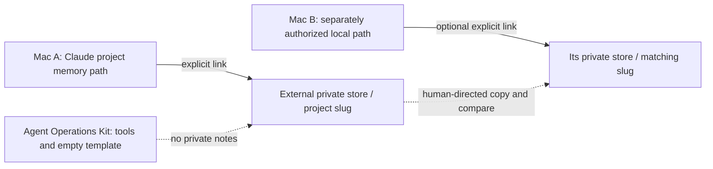

# Private memory placement and multiple Macs

Memory can help a later session find prior decisions, but it also mixes private context with tools. Keep it outside the kit. This optional component relocates a chosen **Claude project memory directory** into an explicitly supplied private store and leaves a link at the native location. It does not provide universal memory or automatic synchronization.



Text equivalent: the kit holds code and guidance; native memory locations can link to a separate private store. Any second-Mac transfer is a manual owner-managed workflow, with one active writer per project.

## Identity and refusal rules

The installer requires `--memory-root` to be absolute and outside the resolved toolkit checkout. A missing/relative root, an in-checkout root or a symlink resolving into the checkout is refused before memory mutation. The project slug follows the provider's absolute-path convention and comes from the repository's physical path, with symlinks resolved, so a second Mac needs the same project-path assumptions or an explicitly adapted mapping.

| Existing local memory | Chosen destination | Result |
|---|---|---|
| Regular populated directory | Empty destination | Relocate with preservation backup, then link |
| Regular populated directory | Populated destination | Refuse; preserve both sides |
| Link to this same fully resolved store | Same store under another canonical spelling | Idempotent; no migration |
| Populated linked store | Different empty or populated store | Refuse; preserve link, old notes and destination |
| Empty/absent local memory | Eligible external destination | Create/link according to installer inventory |

Same-store identity uses fully resolved paths. A relative link target resolves against the link's parent, not the caller's working directory. Comparing raw `readlink` text would misidentify aliases and can lose track of a populated old store.

## Scratch exercise

From the kit root, with bash and `python3` (the stock macOS Python 3.9 works; the inventory warns about it), use only synthetic notes:

```sh
kit="$PWD"
sandbox="$(mktemp -d "${TMPDIR:-/tmp}/agent-ops-memory.XXXXXX")"
mkdir -p "$sandbox/home" "$sandbox/repo-alpha" "$sandbox/private-store"
project="$(cd "$sandbox/repo-alpha" && pwd -P)"
slug="$(printf '%s' "$project" | sed -E 's#[^A-Za-z0-9-]#-#g')"
local_memory="$sandbox/home/.claude/projects/$slug/memory"
mkdir -p "$local_memory"
printf '%s\n' '# Synthetic note' 'Only invented demo content.' > "$local_memory/MEMORY.md"
HOME="$sandbox/home" bash "$kit/agent-orchestration/install.sh" \
  --check --memory-root "$sandbox/private-store" --memory "$project"
HOME="$sandbox/home" bash "$kit/agent-orchestration/install.sh" \
  --apply --memory-root "$sandbox/private-store" --memory "$project"
```

The setup creates one invented note at the provider's exact project-memory slug. It uses `pwd -P` because the installer takes the slug from the physical path, and macOS temporary directories sit behind the `/var` link. Reads: that scratch memory path and the scratch external store. The installer's inventory also runs available CLI version commands and Codex login-status inspection; it makes no model call. Use the owning suite's fake-provider fixtures when real CLI/status access is unsuitable. Writes from memory relocation: the scratch home's project-memory link, selected scratch store and preservation backups reported by the installer. Expected: preview first, then a link whose `MEMORY.md` contains the invented note; the destination is `$sandbox/private-store/$slug/MEMORY.md`. Repeating the apply with the same resolved root is idempotent. Inspect the link, note and backup before deleting the exact scratch directory.

For populated/conflicting-store cases, run the owning `test_install_memory.sh` suite in the documented fixture environment; do not experiment against real notes. This exercise grants no authority to enroll this working checkout or its actual memories in another transfer/synchronization setup.

## Manual migration and undo

1. Stop every writer to this project's memory, including another Mac.
2. Resolve and record the current link and old target. Preserve the link text, old store and any local backup.
3. Copy to a separate candidate destination. Compare both stores and preserve every unique note; do not merge conflicting facts by timestamp alone.
4. Verify destination contents and access. Keep the old store and backups recoverable.
5. Explicitly change only the exact native memory link once the owner has selected the destination. Re-read the resolved link and verify notes through it.
6. To undo, stop writers again, preserve anything written since migration, remove only that link, and restore the matching original directory or prior link. Verify before resuming.

The installer intentionally refuses automated populated-link retargeting and does not merge or delete stores. A second Mac is a separate adoption decision. Matching paths make provider slugs predictable; they do not establish conflict resolution or safe concurrent writes.

## Privacy and recovery limits

The shipped `memory/LINKS` is an empty template, not a project enrollment list. Private notes, project lists and session transcripts remain in an owner-controlled location outside this repository. Inspect notes before any owner-directed sharing; credentials and sensitive records do not become safe because a store is private.

If paths drift, a linked destination disappears, or two machines diverge, stop writers and preserve both sides. Restore a verified local copy or link only after comparison. The kit does not sync accounts, decide which machine is authoritative, or promise durable backup of the external store.
